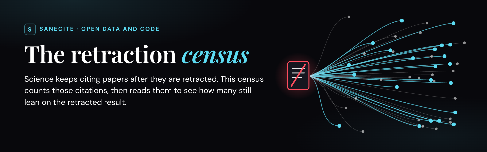
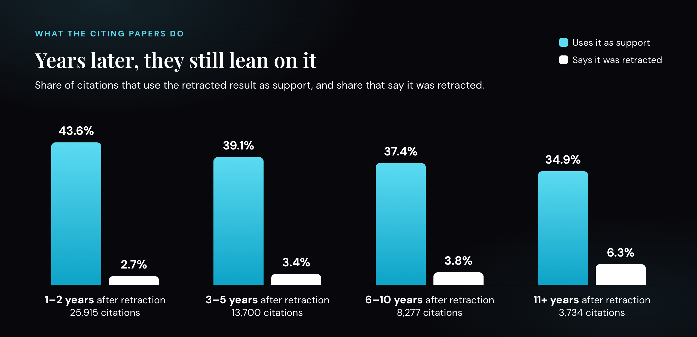

<p align="center">
  
</p>

<p align="center">
  <a href="https://doi.org/10.5281/zenodo.23358099"></a>
  <a href="LICENSE"></a>
  <a href="LICENSE-DATA"></a>
  <a href="https://orcid.org/0009-0001-0250-5446"></a>
  <a href="https://doi.org/10.31222/osf.io/uwqxa_v1"></a>
  <a href="https://sanecite.com"></a>
</p>

When a paper is retracted, other papers keep citing it. This repository counts those citations, reads them, and asks
one question: does the citing paper still cite the retracted result as support? Everything is here: the method (published
before the results), the code, every model answer and every label, so anyone can check or re-run it.

**Read the preprint:** [doi:10.31222/osf.io/uwqxa_v1](https://doi.org/10.31222/osf.io/uwqxa_v1) (MetaArXiv, 27 Oct 2026). How to cite it is at the end of this page.

## What we found

| Figure | What it counts |
|---:|---|
| **<!--f:census_p1_release.citations-->262,998<!--/f-->** | citations made after retraction, across the <!--f:census_p1_release.papers-->51,414<!--/f--> retracted papers checked (OpenAlex, <!--f:census_p1_release.openalex_date-->16 Oct 2026<!--/f-->) |
| **<!--f:census_p1_release.cited_papers-->32,626<!--/f-->** | of those papers (<!--f:census_p1_release.cited_pct0-->63%<!--/f-->) were cited at least once after their retraction |
| **<!--f:census_p2.read-->55,688<!--/f-->** | citations read in full text (22,553 retracted biomedical papers, open-access citing papers in Europe PMC) |
| **<!--f:census_p2.support_pct-->40.7%<!--/f-->** | of the citations judged (<!--f:census_p2.support-->21,037<!--/f--> of <!--f:census_p2.judged-->51,626<!--/f-->) are cited as support |
| **<!--f:census_p2.aware_pct-->3.3%<!--/f-->** | are flagged as retracted or unreliable |

<p align="center"></p>

**How sure are we?**
- The Phase 2 labels come from a panel of three AI models. On <!--f:census_p2.check_n-->150<!--/f--> citations labelled blind by a separate AI model
  (Claude), the panel caught <!--f:census_p2.corr_sens-->96.5%<!--/f--> of the supporting citations, with a false-positive rate of <!--f:census_p2.corr_fpr-->6.5%<!--/f-->. Adjusting for
  that error gives <!--f:census_p2.corr_rate-->38.1%<!--/f--> (95% CI <!--f:census_p2.corr_ci-->33.5-41.8%<!--/f-->). A round of human labelling is next, and every figure is provisional
  until it is done.
- A citation-level audit of the <!--f:census_p1_release.citations-->262,998<!--/f--> (200 random draws, checked against each citing paper's own reference list)
  found about 96.5% to be real citations. The rest were wrong links, retraction notices or duplicate records. So
  about 254,000 (247,000-260,000) are real citations.
- A citation is a flag, not a verdict. Every author named in our reports is asked to respond before publication.

## Support this work

SaneCite is an independent scientific research project. It sells nothing: no services, no data, no early or
exclusive access, and every result is published free to everyone. Reading a citation costs fractions of a cent; the expensive part is
experts checking the machine's calls, and that is what funding pays for.

- **Pledge:** [sanecite.com/donate](https://sanecite.com/donate). Pledges are not binding while a nonprofit fiscal
  sponsor is finalized; pledgers hear first when that giving opens. Gifts are not tax-deductible yet.
- **Foundations and research funders:** to fund the human check or the next phase, write to
  [hi@saneapps.com](mailto:hi@saneapps.com). Funders do not choose what is checked or see results early.
- **Free ways to help:** cite the dataset, re-run the code, and
  [open an issue](https://github.com/MrSaneApps/sanecite-retraction-census/issues) for any error you find. We
  correct mistakes in public.

From the day SaneCite has a fiscal sponsor, every gift and every spend will be published, with what it paid for.

## What's in this repository

| Path | What it is |
|---|---|
| [`PROTOCOL.md`](PROTOCOL.md) | The analysis plan, registered before the final analysis, with every dated amendment |
| [`codebook.md`](codebook.md) | The questions the models answer and the rules that turn answers into labels |
| [`phase1/`](phase1/) | Phase 1: the count of citations made after retraction (Retraction Watch, Crossref, OpenAlex) |
| [`scripts/`](scripts/) | Phase 2: build the frame, extract citing passages, label them, analyse |
| [`data/`](data/) | The census: frame, every citing passage, each model's answer, final labels, results |
| [`validation/`](validation/) | Blind answer keys and scores for the model panel |
| [`human_labels/`](human_labels/) | The human labelling round: draw and instructions, scoring fixed in advance |
| [`lists/`](lists/) | The named Lists on sanecite.com and the charts: code, inputs and published files, with a re-run that rebuilds each file byte for byte (`lists/README.md`) |
| [`checker/`](checker/) | The citation-accuracy test of the checker (batches 6 and 7): plans, hash log, reads, scores (`checker/README.md`) |
| [`stories/`](stories/) | Code and data behind sanecite.com/stories, including the Saez-Zucman audit check (`stories/README.md`) |
| [`flags/`](flags/) | The census flags per citing paper and the open flag format, as sanecite.com/data serves them (`flags/README.md`) |
| [`models/`](models/) | Every model test, 13 to 31 Oct 2026 (`models/README.md`) |
| [`EDITIONS.md`](EDITIONS.md) | The rule for re-runs with new models or prompts: a new edition, never mixed with an old one |
| [`errata/`](errata/) | The 20 Oct 2026 census correction as data: the wrong Retraction Watch records and the pairs they carry |
| [`MANIFEST.sha256`](MANIFEST.sha256) | Dated blocks of file hashes, added each time files are registered or changed |

**Reading the manifest.** `MANIFEST.sha256` only grows: each dated block records the files registered or changed on
that date, so older lines describe older versions. `python3 scripts/verify_manifest.py` checks every file against its
latest hash and lists the earlier hashes as history.

**Data files** (`data/`): `stage1_papers.jsonl.gz` (the 22,553 retracted papers, with Retraction Watch reason, dates
and later-citation counts), `stage2_v31.jsonl.gz` (every extracted citing passage), `stage3_{jev,clef,gemma}.jsonl.gz`
(each model's answer per passage), `census_rows.jsonl.gz` (the label per citing pair), `citer_meta.jsonl.gz` (Europe
PMC metadata for all <!--f:census_p2.later-->130,315<!--/f--> later citations), `paper_numbers.md` (every figure quoted) and the result files. Citing
passages are short quotations from open-access papers, included so each label can be checked against its text; they
stay under each source article's own license (see `LICENSE-DATA`).
Hsiao and Schneider's data are not redistributed here (Illinois Data Bank, doi:10.13012/B2IDB-8255619_V2).

## Re-run it

Re-create the published results from the released data (about a minute, no accounts needed):

```sh
mkdir work
for f in data/*.gz; do gunzip -c "$f" > "work/$(basename "${f%.gz}")"; done
cp validation/* work/
SANECITE_DATA=work python3 scripts/analyze_census.py
```

`work/census_results.json` matches `data/census_results.json`. Other analyses are listed in `PROTOCOL.md`.

- **Phase 1 count:** see [`phase1/README.md`](phase1/README.md). It needs the Retraction Watch file from Crossref
  Labs and, for a full run, an OpenAlex API key.
- **Re-label citations with the models:** `scripts/stage3_census.py` through `scripts/model_calls.py`. It needs a
  Cloudflare account (`CLOUDFLARE_API_TOKEN`, `CLOUDFLARE_ACCOUNT_ID`).

## Cite

Joseph, S. (2026). *SaneCite retraction census: post-retraction citations to 22,553 retracted biomedical papers
(protocol, code and data)*. Zenodo. https://doi.org/10.5281/zenodo.23358099

This DOI always points to the latest version; each version also has its own DOI on Zenodo. GitHub's "Cite this
repository" button uses [`CITATION.cff`](CITATION.cff).

The citation labels are also on Hugging Face for easy loading: [SaneCite/retraction-census](https://huggingface.co/datasets/SaneCite/retraction-census).
It is a mirror; please cite the Zenodo record above.

## History

- **13 Oct 2026:** protocol registered before the final analysis.
- **14 Oct 2026:** census data released (amendment 3); human labelling scoring fixed before any answers exist
  (amendment 4).
- **15 Oct 2026:** rates reported as counts over totals to fix a rounding error (headline 40.7%, not 40.8%).
- **16 Oct 2026:** all code released (amendment 5, version 1.1.0). The Phase 1 count now leaves out administrative
  retractions, the rule Phase 2 always used (<!--f:census_p1_release.citations-->262,998<!--/f-->, down from 286,050).
- **20 Oct 2026:** census correction (amendment 11 repair). <!--f:census_p2.fix_removed-->12<!--/f--> citation pairs sat on Retraction Watch records
  whose identifier points to a different paper. Corrected counts: <!--f:census_p2.read_fix-->55,676<!--/f--> citations read, <!--f:census_p2.judged_fix-->51,614<!--/f--> judged,
  <!--f:census_p2.support_fix-->21,032<!--/f--> cited as support. The headline rates are unchanged (<!--f:census_p2.support_fix_pct-->40.7%<!--/f--> support, <!--f:census_p2.aware_fix_pct-->3.3%<!--/f--> flagged;
  AI-key corrected <!--f:census_p2.corr_rate-->38.1%<!--/f-->). A few subgroup rates move by about 0.1 point (first two years after retraction 43.6% to
  43.5%; flagged after ten years 6.3% to 6.4%). The counts above are the as-published ones; this note is the
  correction of record. `errata/wrong_records.csv` lists the records and pairs, each census row carries
  `wrong_record`, and `scripts/analyze_census.py` reports both sets of totals (`corrected_wrong_records`). The same check on all <!--f:census_p2_frame.frame_records-->22,553<!--/f--> frame records found <!--f:census_p2_frame.wrong_records-->70<!--/f--> wrong records with <!--f:census_p2_frame.wrong_later-->86<!--/f--> later citations, the <!--f:census_p2.fix_removed-->12<!--/f--> among them (`errata/README.md`).
  Without them the frame is <!--f:census_p2_frame.frame_papers-->22,483<!--/f--> papers, <!--f:census_p2_frame.cited_later-->15,992<!--/f--> of them cited in a later year, with <!--f:census_p2_frame.later-->130,229<!--/f--> later citations. The preprint
  ([doi:10.31222/osf.io/uwqxa_v1](https://doi.org/10.31222/osf.io/uwqxa_v1)) uses this corrected frame, where the interval for
  the flagged share is <!--f:census_p2_frame.aware_ci-->2.7-4.2%<!--/f--> (<!--f:census_p2.aware_ci-->2.6-4.3%<!--/f--> as published). The title, the figures above and the data
  files keep the published frame.
- **20 Oct 2026:** post-hoc check of the "reference list says retracted" flag (`scripts/reflist_marks.py`,
  `data/reflist_marks.json`; not in the registered protocol). The flag is set whenever "retract" appears in the
  citing paper's reference entry. On the 3,187 entries with a clear mark (a title prefix such as "RETRACTED:", or a
  retraction note), 41.5% (1,322) are cited as support, against 40.4% (1,465 of 3,628) for all flagged entries. The
  other 441 entries mention it in other formats (32.4% cited as support).
- **20 Oct 2026:** post-hoc breakdown by Retraction Watch subject (`scripts/subject_breakdown.py`,
  `data/subject_breakdown.json`, `data/paper_subjects.csv`; not in the registered protocol). Each citation counts under
  every top-level subject its retracted paper carries. Support rates run from 31.4% (business and technology, 1,858
  citations) to 42.5% (basic life sciences, 37,031). Two notes on the registered field grouping (`groups.field_group`):
  its "other fields" group is any paper with a subject outside basic life and health sciences, often alongside them,
  not papers with neither; and its code pattern skips the "B/T" code, so the 82 citations to papers coded only B/T
  are in its "?" group. The registered figures are unchanged.
- **23 Oct 2026:** the 20 Oct correction published as data (`errata/`); `scripts/stage_release.py` to stage the code
  and data of the named Lists and of the checker's accuracy test on release day; data licensed CC BY 4.0, code
  still MIT; `MANIFEST.sha256` given a block for every file changed since registration and a checker
  (`scripts/verify_manifest.py`).
- **9 Nov 2026:** version 1.4.0, matching what sanecite.com published that day.
  - Accuracy test, batch 7 (`checker/`): the registered answer key (`records/PREREG_REFSET_B7_2026-10-31.md`, with
    internal names replaced as `checker/README.md` lists), the registered scorer and the result as the site serves it
    (`batch7-result.json`). Pooled with batch 6, blind AI reads found <!--f:stage3.pmajor_pct-->7.7%<!--/f--> (<!--f:stage3.p_major-->166<!--/f--> of the <!--f:stage3.p_judged-->2,156<!--/f--> citations they
    could judge; 95% CI <!--f:stage3.pmajor_ci-->6.6-8.9%<!--/f-->) that badly misreport the cited paper. In batch 7, <!--f:stage3.b7any_pct-->19.2%<!--/f--> have some error
    when a third read settles reader disagreements and <!--f:stage3.b7any23_pct-->15.7%<!--/f--> when a two-of-three vote does
    (`scripts/b7/two_of_three_20261109.py`). These are AI reads; no person has checked them yet.
  - Economics pilot: `lists/data/econ-result.json` and `lists/charts-csv/econ.csv`, behind the new chart. Of <!--f:econ.judged-->231<!--/f-->
    judged citations to retracted economics papers, <!--f:econ.support_pct-->38.1%<!--/f--> cite them as support (95% CI <!--f:econ.support_ci-->32.1-44.5%<!--/f-->), against
    <!--f:econ.med_pct-->40.7%<!--/f--> in the biomedical census. The pilot's own code is not in this repository yet.
  - Lists (`lists/`): staged again from the site. Retraction years now follow each notice's online date where it
    came before the print issue (`lists/data/list_corrections.json`), and the page code has the new section "Also
    written to, not ranked": the journals and authors just below the cut that were sent their findings and whose
    reply window has closed. That section's data holds our letters and their replies, so it stays private; the page
    shows it. `lists/rerun.py` also rebuilds the economics chart file.
  - Stories (`stories/sz-check/`): our check of the anonymous AI audit of Saez and Zucman's research. Of the <!--f:szcheck.flags-->147<!--/f-->
    problems the audit says change a headline number, <!--f:szcheck.changes-->21<!--/f--> do. A pre-registered second pass graded the <!--f:szcheck.sp_n-->99<!--/f--> method choices first
    counted as disputed (`second-pass/`). The data, the PDF report and the page code are as the site serves them.
- **9 Nov 2026, afternoon:** version 1.4.1, with the corrections sanecite.com published that afternoon.
  - First-online rule (Lists and flags): a citation now counts only if the citing paper first went online after the
    earliest dated sign of the retraction (the Retraction Watch date and the notice's dates in PubMed and Crossref,
    both known to the day). Before, a citing paper from a later year than the retraction counted, and a paper's year
    is its print issue, which can come months after it went online. We found <!--f:first_online.found-->302<!--/f--> such citations on the Lists and
    checked every date again in PubMed and Crossref; <!--f:first_online.held-->296<!--/f--> held up and are left out (<!--f:first_online.support-->145<!--/f--> cited as support,
    <!--f:first_online.passing-->148<!--/f--> in passing, <!--f:first_online.aware-->3<!--/f--> flagged as retracted). The papers and authors on the Lists do not change. Each
    citation left out is in `lists/data/list_corrections.json` with both dates and their sources; the rule is
    explained at https://sanecite.com/methods#dates.
  - More full-text relabels (cited as support to flagged as retracted or unreliable), among them a 2022 review in
    Science Progress that left the retracted trial out of its analysis, and retraction years set by the notice's
    online date. Each is in `lists/data/list_corrections.json` with its source.
  - Flags (`flags/`, new): the per-paper flag file and the open flag format, as sanecite.com/data serves them. After
    all of that day's corrections the census has <!--f:first_online.flags_after-->43,818<!--/f--> flags (<!--f:first_online.flags_before-->44,132<!--/f--> before).
  - The Phase 2 census figures above stay as published. With the first-online rule, <!--f:census_p2b.dropped-->337<!--/f--> census citations would
    be left out, and <!--f:census_p2b.support_pct-->40.7%<!--/f--> of the <!--f:census_p2b.judged-->51,293<!--/f--> judged would still be cited as support (95% CI <!--f:census_p2b.support_ci-->39.9-41.4%<!--/f-->).

## Contact and license

Stephan Joseph, Georgia, USA · [hi@saneapps.com](mailto:hi@saneapps.com) ·
[ORCID 0009-0001-0250-5446](https://orcid.org/0009-0001-0250-5446) · [sanecite.com](https://sanecite.com)

## How to cite

The paper: Joseph S. "Retracted, still cited as support: a census of post-retraction citations to 22,483 retracted biomedical papers." MetaArXiv, 2026. https://doi.org/10.31222/osf.io/uwqxa_v1

The data and code: cite the census release, https://doi.org/10.5281/zenodo.23358099 (always the latest version; each version has its own DOI). `CITATION.cff` gives both.

Code under the [MIT license](LICENSE). Data that SaneCite made (labels, counts, Lists, corrections) under
[CC BY 4.0](LICENSE-DATA); quoted passages stay under each source article's license, and Retraction Watch records under
the terms of Crossref and Retraction Watch. AI use: language models produce the labels, and Claude (Anthropic)
wrote most of the code; see `PROTOCOL.md`.
