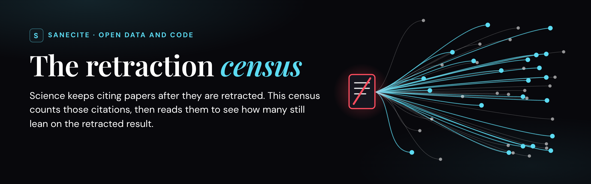
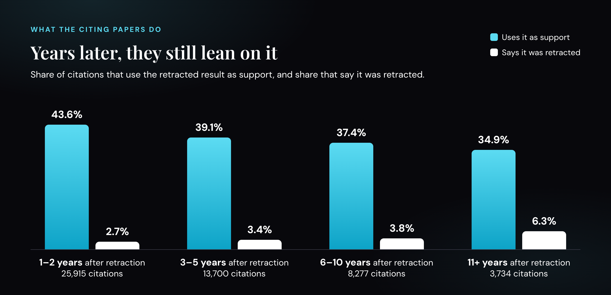

<p align="center">
  
</p>

<p align="center">
  <a href="https://doi.org/10.5281/zenodo.23358099"></a>
  <a href="LICENSE"></a>
  <a href="LICENSE-DATA"></a>
  <a href="https://orcid.org/0009-0001-0250-5446"></a>
  <a href="https://sanecite.com"></a>
</p>

When a paper is retracted, other papers keep citing it. This repository counts those citations, reads them, and asks
one question: does the citing paper still cite the retracted result as support? Everything is here: the method (published
before the results), the code, every model answer and every label, so anyone can check or re-run it.

## What we found

| Figure | What it counts |
|---:|---|
| **<!--f:census_p1_release.citations-->262,998<!--/f-->** | citations made after retraction, across the <!--f:census_p1_release.papers-->51,414<!--/f--> retracted papers checked (OpenAlex, <!--f:census_p1_release.openalex_date-->16 Oct 2026<!--/f-->) |
| **<!--f:census_p1_release.cited_papers-->32,626<!--/f-->** | of those papers (<!--f:census_p1_release.cited_pct0-->63%<!--/f-->) were cited at least once after their retraction |
| **<!--f:census_p2.read-->55,688<!--/f-->** | citations read in full text (22,553 retracted biomedical papers, open-access citing papers in Europe PMC) |
| **<!--f:census_p2.support_pct-->40.7%<!--/f-->** | of the citations judged (<!--f:census_p2.support-->21,037<!--/f--> of <!--f:census_p2.judged-->51,626<!--/f-->) are cited as support |
| **<!--f:census_p2.aware_pct-->3.3%<!--/f-->** | are flagged as retracted or unreliable |

<p align="center"></p>

**How sure are we?**
- The Phase 2 labels come from a panel of three AI models. On <!--f:census_p2.check_n-->150<!--/f--> citations labelled blind by a separate AI model
  (Claude), the panel caught <!--f:census_p2.corr_sens-->96.5%<!--/f--> of the supporting citations, with a false-positive rate of <!--f:census_p2.corr_fpr-->6.5%<!--/f-->. Adjusting for
  that error gives <!--f:census_p2.corr_rate-->38.1%<!--/f--> (95% CI <!--f:census_p2.corr_ci-->33.5-41.8%<!--/f-->). A round of human labelling is next, and every figure is provisional
  until it is done.
- A citation-level audit of the <!--f:census_p1_release.citations-->262,998<!--/f--> (200 random draws, checked against each citing paper's own reference list)
  found about 96.5% to be real citations. The rest were wrong links, retraction notices or duplicate records. So
  about 254,000 (247,000-260,000) are real citations.
- A citation is a flag, not a verdict. Every author named in our reports is asked to respond before publication.

## Support this work

SaneCite is an independent scientific research project. It sells nothing: no services, no data, no early or
exclusive access, and every result is published free to everyone. Reading a citation costs fractions of a cent; the expensive part is
experts checking the machine's calls, and that is what funding pays for.

- **Pledge:** [sanecite.com/donate](https://sanecite.com/donate). Pledges are not binding while a nonprofit fiscal
  sponsor is finalized; pledgers hear first when that giving opens. Gifts are not tax-deductible yet.
- **Foundations and research funders:** to fund the human check or the next phase, write to
  [hi@saneapps.com](mailto:hi@saneapps.com). Funders do not choose what is checked or see results early.
- **Free ways to help:** cite the dataset, re-run the code, and
  [open an issue](https://github.com/MrSaneApps/sanecite-retraction-census/issues) for any error you find. We
  correct mistakes in public.

From the day SaneCite has a fiscal sponsor, every gift and every spend will be published, with what it paid for.

## What's in this repository

| Path | What it is |
|---|---|
| [`PROTOCOL.md`](PROTOCOL.md) | The analysis plan, registered before the final analysis, with every dated amendment |
| [`codebook.md`](codebook.md) | The questions the models answer and the rules that turn answers into labels |
| [`phase1/`](phase1/) | Phase 1: the count of citations made after retraction (Retraction Watch, Crossref, OpenAlex) |
| [`scripts/`](scripts/) | Phase 2: build the frame, extract citing passages, label them, analyse |
| [`data/`](data/) | The census: frame, every citing passage, each model's answer, final labels, results |
| [`validation/`](validation/) | Blind answer keys and scores for the model panel |
| [`human_labels/`](human_labels/) | The human labelling round: draw and instructions, scoring fixed in advance |
| [`EDITIONS.md`](EDITIONS.md) | The rule for re-runs with new models or prompts: a new edition, never mixed with an old one |
| [`errata/`](errata/) | The 20 Oct 2026 census correction as data: the wrong Retraction Watch records and the pairs they carry |
| [`MANIFEST.sha256`](MANIFEST.sha256) | Dated blocks of file hashes, added each time files are registered or changed |

**Reading the manifest.** `MANIFEST.sha256` only grows: each dated block records the files registered or changed on
that date, so older lines describe older versions. `python3 scripts/verify_manifest.py` checks every file against its
latest hash and lists the earlier hashes as history.

**Data files** (`data/`): `stage1_papers.jsonl.gz` (the 22,553 retracted papers, with Retraction Watch reason, dates
and later-citation counts), `stage2_v31.jsonl.gz` (every extracted citing passage), `stage3_{jev,clef,gemma}.jsonl.gz`
(each model's answer per passage), `census_rows.jsonl.gz` (the label per citing pair), `citer_meta.jsonl.gz` (Europe
PMC metadata for all <!--f:census_p2.later-->130,315<!--/f--> later citations), `paper_numbers.md` (every figure quoted) and the result files. Citing
passages are short quotations from open-access papers, included so each label can be checked against its text; they
stay under each source article's own license (see `LICENSE-DATA`).
Hsiao and Schneider's data are not redistributed here (Illinois Data Bank, doi:10.13012/B2IDB-8255619_V2).

## Re-run it

Re-create the published results from the released data (about a minute, no accounts needed):

```sh
mkdir work
for f in data/*.gz; do gunzip -c "$f" > "work/$(basename "${f%.gz}")"; done
cp validation/* work/
SANECITE_DATA=work python3 scripts/analyze_census.py
```

`work/census_results.json` matches `data/census_results.json`. Other analyses are listed in `PROTOCOL.md`.

- **Phase 1 count:** see [`phase1/README.md`](phase1/README.md). It needs the Retraction Watch file from Crossref
  Labs and, for a full run, an OpenAlex API key.
- **Re-label citations with the models:** `scripts/stage3_census.py` through `scripts/model_calls.py`. It needs a
  Cloudflare account (`CLOUDFLARE_API_TOKEN`, `CLOUDFLARE_ACCOUNT_ID`).

## Cite

Joseph, S. (2026). *SaneCite retraction census: post-retraction citations to 22,553 retracted biomedical papers
(protocol, code and data)*. Zenodo. https://doi.org/10.5281/zenodo.23358099

This DOI always points to the latest version; each version also has its own DOI on Zenodo. GitHub's "Cite this
repository" button uses [`CITATION.cff`](CITATION.cff).

## History

- **13 Oct 2026:** protocol registered before the final analysis.
- **14 Oct 2026:** census data released (amendment 3); human labelling scoring fixed before any answers exist
  (amendment 4).
- **15 Oct 2026:** rates reported as counts over totals to fix a rounding error (headline 40.7%, not 40.8%).
- **16 Oct 2026:** all code released (amendment 5, version 1.1.0). The Phase 1 count now leaves out administrative
  retractions, the rule Phase 2 always used (<!--f:census_p1_release.citations-->262,998<!--/f-->, down from 286,050).
- **20 Oct 2026:** census correction (amendment 11 repair). <!--f:census_p2.fix_removed-->12<!--/f--> citation pairs sat on Retraction Watch records
  whose identifier points to a different paper. Corrected counts: <!--f:census_p2.read_fix-->55,676<!--/f--> citations read, <!--f:census_p2.judged_fix-->51,614<!--/f--> judged,
  <!--f:census_p2.support_fix-->21,032<!--/f--> cited as support. The headline rates are unchanged (<!--f:census_p2.support_fix_pct-->40.7%<!--/f--> support, <!--f:census_p2.aware_fix_pct-->3.3%<!--/f--> flagged;
  AI-key corrected <!--f:census_p2.corr_rate-->38.1%<!--/f-->). A few subgroup rates move by about 0.1 point (first two years after retraction 43.6% to
  43.5%; flagged after ten years 6.3% to 6.4%). The counts above are the as-published ones; this note is the
  correction of record. `errata/wrong_records.csv` lists the records and pairs, each census row carries
  `wrong_record`, and `scripts/analyze_census.py` reports both sets of totals (`corrected_wrong_records`).
- **20 Oct 2026:** post-hoc check of the "reference list says retracted" flag (`scripts/reflist_marks.py`,
  `data/reflist_marks.json`; not in the registered protocol). The flag is set whenever "retract" appears in the
  citing paper's reference entry. On the 3,187 entries with a clear mark (a title prefix such as "RETRACTED:", or a
  retraction note), 41.5% (1,322) are cited as support, against 40.4% (1,465 of 3,628) for all flagged entries. The
  other 441 entries mention it in other formats (32.4% cited as support).
- **20 Oct 2026:** post-hoc breakdown by Retraction Watch subject (`scripts/subject_breakdown.py`,
  `data/subject_breakdown.json`, `data/paper_subjects.csv`; not in the registered protocol). Each citation counts under
  every top-level subject its retracted paper carries. Support rates run from 31.4% (business and technology, 1,858
  citations) to 42.5% (basic life sciences, 37,031). Two notes on the registered field grouping (`groups.field_group`):
  its "other fields" group is any paper with a subject outside basic life and health sciences, often alongside them,
  not papers with neither; and its code pattern skips the "B/T" code, so the 82 citations to papers coded only B/T
  are in its "?" group. The registered figures are unchanged.
- **23 Oct 2026:** the 20 Oct correction published as data (`errata/`); `scripts/stage_release.py` to stage the code
  and data of the named Lists and of the checker's accuracy test on release day; data licensed CC BY 4.0, code
  still MIT; `MANIFEST.sha256` given a block for every file changed since registration and a checker
  (`scripts/verify_manifest.py`).

## Contact and license

Stephan Joseph, SaneApps, Dahlonega, Georgia · [hi@saneapps.com](mailto:hi@saneapps.com) ·
[ORCID 0009-0001-0250-5446](https://orcid.org/0009-0001-0250-5446) · [sanecite.com](https://sanecite.com)

Code under the [MIT license](LICENSE). Data that SaneCite made (labels, counts, Lists, corrections) under
[CC BY 4.0](LICENSE-DATA); quoted passages stay under each source article's license, and Retraction Watch records under
the terms of Crossref and Retraction Watch. AI use: language models produce the labels, and Claude (Anthropic)
wrote most of the code; see `PROTOCOL.md`.
